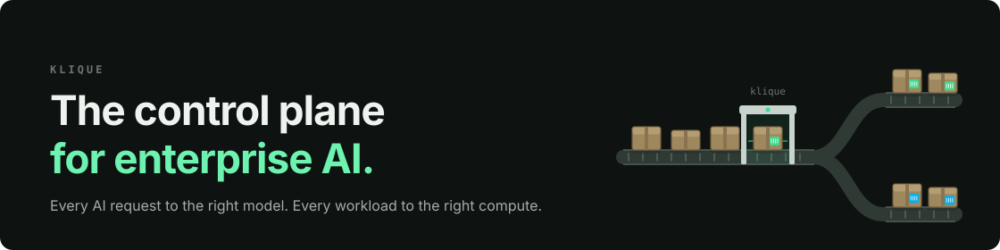
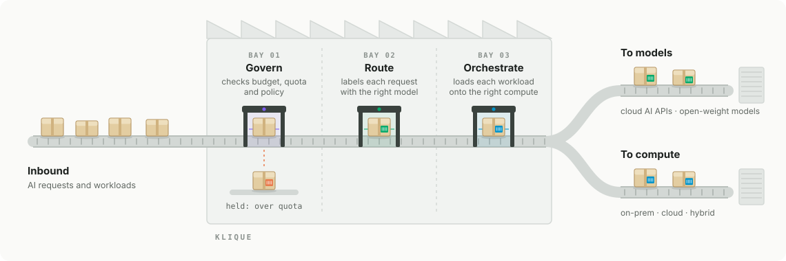

  <picture>
    <source media="(prefers-color-scheme: dark)" srcset="https://klique.ai/assets/images/klique-logo-white.svg">
    
  </picture>

Klique routes every AI request to the right model and every AI workload to the right compute. Budgets, quotas and policies are enforced in one vendor-agnostic control plane, on-premises, in the cloud or both.

## One control plane, three engines

Every AI request and every AI workload in your organization passes through Klique on its way to a model or to compute:

  <picture>
    <source media="(prefers-color-scheme: dark)" srcset="images/platform-dark.svg">
    
  </picture>

- **Route.** Smart routing sends each AI request to the right model, and each workload to the right cluster.
- **Govern.** AI service management wraps every model endpoint in a governed gateway, with budgets, quotas, keys, SSO and audit trails.
- **Orchestrate.** GPU orchestration pools GPUs, CPUs and cloud AI APIs, with fractional sharing and priority scheduling.

The same platform serves the people using agentic tools and AI apps, and the teams building and training models. It runs wherever your data lives: on-premises, in the cloud or hybrid.

## Open source

| Project | What it does |
|---|---|
| [**Klique Idle GPU Dashboard**](https://github.com/klique-ai/klique-idle) | Find out how much of your GPU capacity sits idle, and what it's worth in tokens and dollars. An open-source collector for NVIDIA GPU clusters on Kubernetes, Slurm, PBS and bare metal. |

## Learn more

- [klique.ai](https://klique.ai): the platform, solutions and pricing
- [Documentation](https://klique.ai/docs/latest/docs/)
- [YouTube](https://www.youtube.com/@KliqueAI)
- [Request a demo](https://klique.ai/demo/) or [contact us](https://klique.ai/contact-us/)

**Take control of your AI. All of it.**
